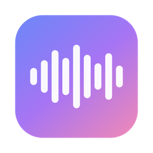
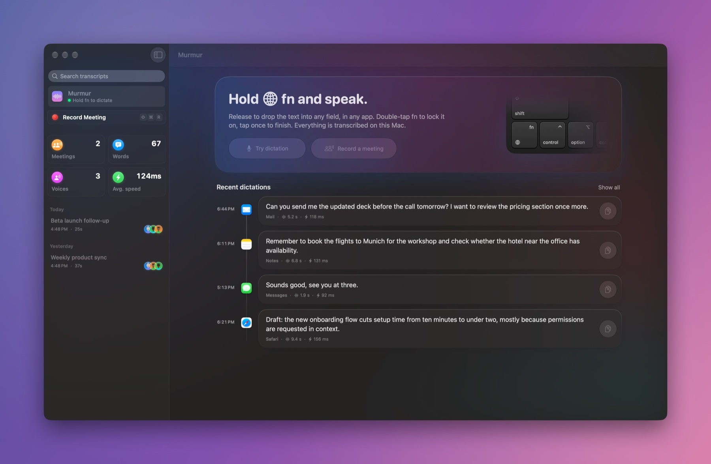
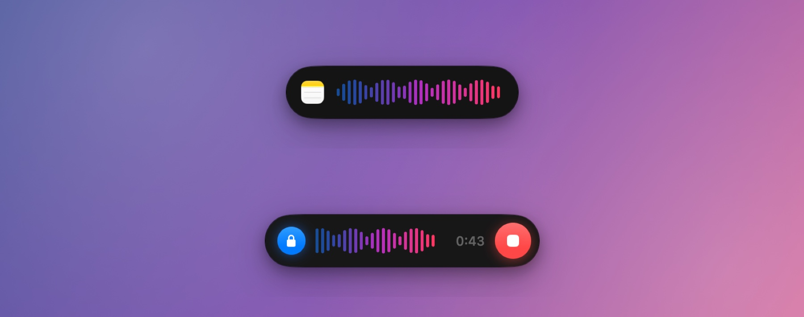
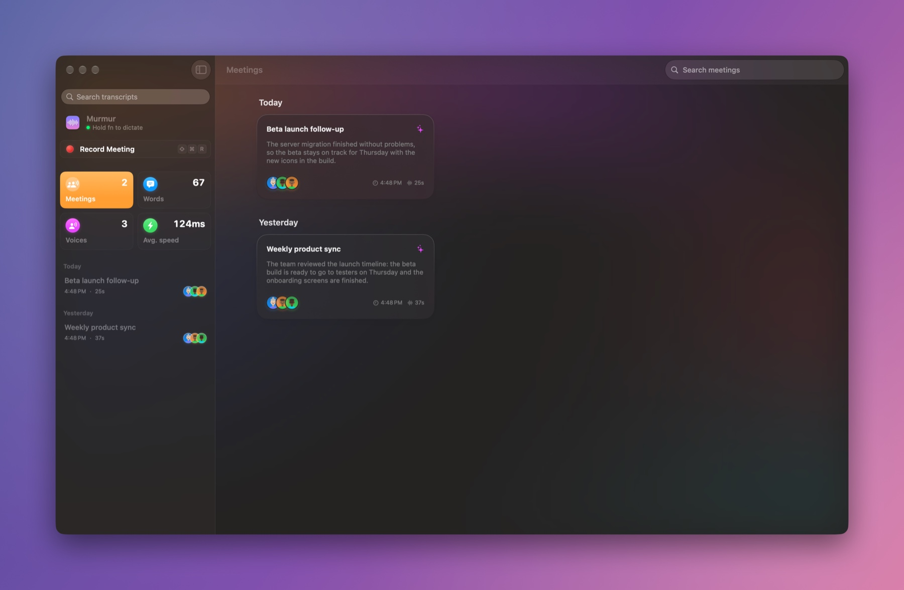
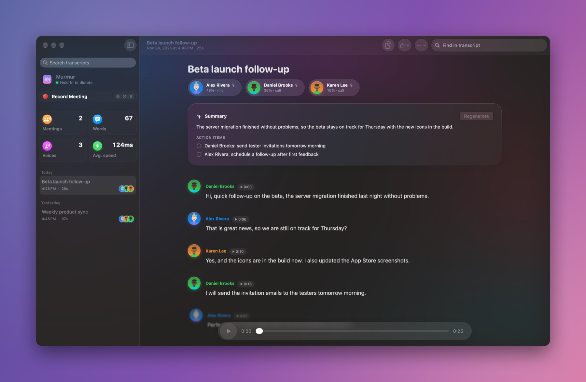
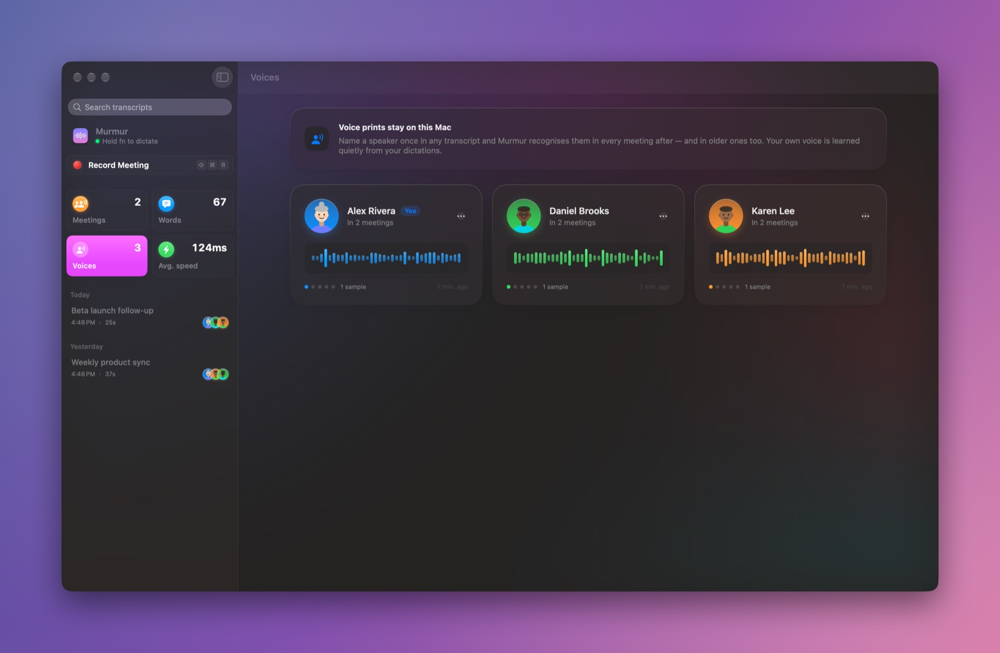
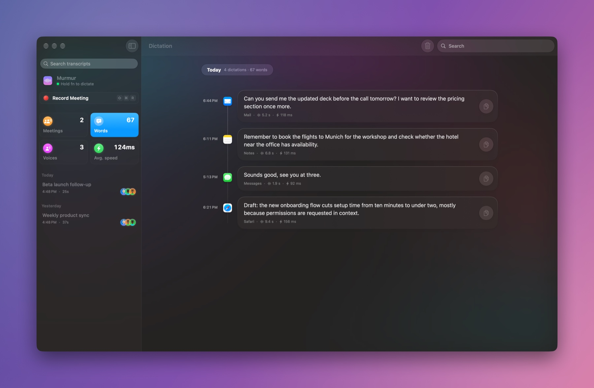

<p align="center">
  
</p>

<h1 align="center">Murmur</h1>

<p align="center">
  <strong>Dictate anywhere with the fn key. Transcribe meetings and know who said what.<br>All on your Mac, nothing in the cloud.</strong>
</p>

<p align="center">
  <a href="https://github.com/patrickfreyer/Murmur/releases/latest"></a>
  
  
  
</p>

<p align="center">
  
</p>

## What it does

**Dictate into any app.** Hold <kbd>fn</kbd>, speak, and let go. The text lands in whatever field has focus: Mail, Slack, a browser, your editor. A typical sentence is transcribed in around 100 ms.

- Hold <kbd>fn</kbd> to talk, release to insert
- Double-tap <kbd>fn</kbd> to lock it on for longer dictation, then tap once to finish
- <kbd>esc</kbd> cancels
- Spacing and capitalisation adapt to the text that's already around your cursor
- Your clipboard is put back the way it was

<p align="center">
  
</p>

**Record meetings.** One click records your microphone and the call audio from Zoom, Meet, Teams or any other app. It uses a Core Audio process tap, so it doesn't need screen-recording permission. You see a live transcript while you talk. When you stop, Murmur makes a full pass that identifies each speaker and, if you want, writes a summary with Apple Intelligence on the device.

**Voice prints that remember people.** Name a speaker once and Murmur recognises that voice in every later meeting, and goes back and labels older ones too. It learns your own voice quietly from your dictations. Voice prints are numeric fingerprints stored only on your Mac.

| Meetings | A transcript, speakers recognised by voice |
|---|---|
|  |  |
| **Voices** | **Dictation history** |
|  |  |

## Install

1. Download **Murmur-x.y.z.zip** from [Releases](https://github.com/patrickfreyer/Murmur/releases/latest), unzip it and drag **Murmur.app** into **Applications**.
2. The first time you open it, macOS will say it can't verify the developer, because the app isn't notarized yet. Go to **System Settings → Privacy & Security** and click **Open Anyway**.
3. Allow **Microphone** and **Accessibility** when Murmur asks. Accessibility lets it see the fn key and paste text.
4. Recommended: **System Settings → Keyboard → "Press 🌐 key to" → Do Nothing**, so the emoji picker doesn't pop up when you use fn.
5. The first launch downloads the speech model, about 0.5 GB. After that, everything works offline.

The first time you record a meeting, Murmur asks for **System Audio Recording**.

**Requirements:** an Apple Silicon Mac running macOS 26 or later.

## Privacy

- Audio, transcripts and voice prints never leave your Mac. There is no account, analytics or server.
- The only network requests download the open-source models from Hugging Face the first time they're needed.
- Your data lives in `~/Library/Application Support/Murmur` and the models in `~/Library/Application Support/FluidAudio`. Delete those folders and it's all gone.

## How it works

| Piece | Technology |
|---|---|
| Speech to text | NVIDIA Parakeet TDT (Ultra, v3 or v2) running on the Neural Engine with Core ML, via [FluidAudio](https://github.com/FluidInference/FluidAudio) |
| Who spoke when | pyannote segmentation, WeSpeaker embeddings and VBx clustering, also via FluidAudio |
| Voice prints | Running averages of speaker embeddings, matched by cosine similarity |
| Call audio | `CATapDescription` process tap feeding a private aggregate device |
| Echo from your speakers | Mic speaker clusters whose voice matches a call participant are dropped |
| fn key | `CGEventTap` |
| Text insertion | Pasteboard plus a synthetic ⌘V; the clipboard is restored afterwards |
| Summaries | Apple Foundation Models, on device |
| UI | SwiftUI with Liquid Glass |

Parakeet's token-and-duration decoder is non-autoregressive and runs on the Neural Engine, which is why dictation feels instant compared with Whisper-based apps.

## Build from source

```bash
git clone https://github.com/patrickfreyer/Murmur.git
cd Murmur
Scripts/build-app.sh release --install   # builds, signs and copies to /Applications
swift test                               # unit tests
```

You need Xcode 26 or later. If your keychain has an **Apple Development** certificate, the build script signs with it, and the Accessibility permission survives rebuilds. Without one it falls back to ad-hoc signing, and you'll have to grant Accessibility again after each build.

```
Sources/
  MurmurCore/      audio capture, speech engine, diarization, voice prints, storage (testable, no UI)
  Murmur/          the app: SwiftUI views, HUD, menu bar, settings
Tests/MurmurTests/ unit tests (gesture timing, voice matching, transcript assembly, echo filter)
Scripts/           build, release, demo data and screenshot tooling
```

### End-to-end self-test

This generates two spoken meetings with the macOS voices, transcribes and diarizes them, names the speakers in the first one, and checks that the second one is labelled automatically:

```bash
swift Scripts/make-test-meeting.swift /tmp/fx-a a
swift Scripts/make-test-meeting.swift /tmp/fx-b b
swift build -c release
MURMUR_HOME=/tmp/murmur-test .build/release/Murmur --selftest /tmp/fx-a /tmp/fx-b
```

## Credits

Murmur stands on excellent open work: [FluidAudio](https://github.com/FluidInference/FluidAudio) (Apache 2.0), NVIDIA [Parakeet](https://huggingface.co/nvidia/parakeet-tdt-0.6b-v3) (CC-BY-4.0), [pyannote](https://github.com/pyannote/pyannote-audio) (MIT) and [WeSpeaker](https://github.com/wenet-e2e/wespeaker) (Apache 2.0). The models are downloaded at runtime and are not redistributed in this repository.

## License

[MIT](LICENSE)
